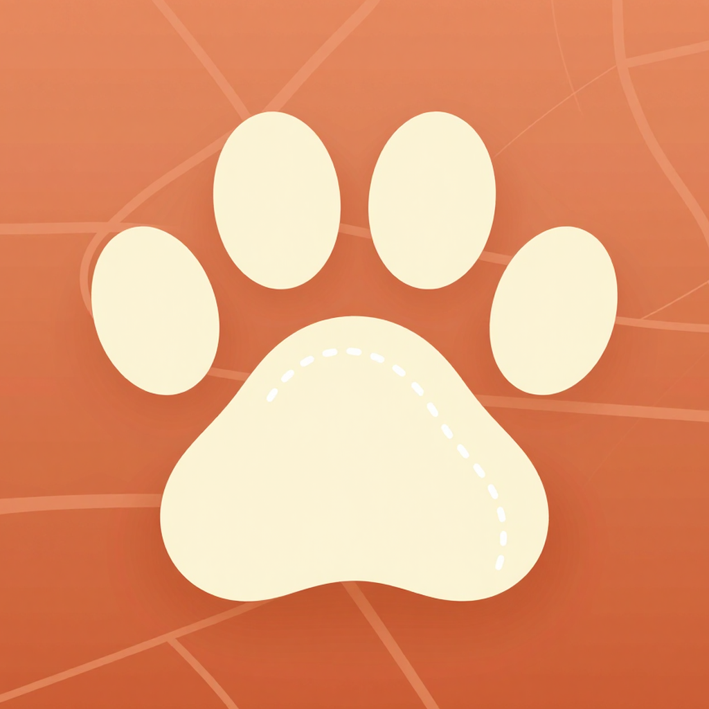

# Pati Rotası

Yürüyerek keşfet, gerçek kedileri fotoğrafla ve Pokémon gibi koleksiyonuna kat. Amaç insanları dışarı çıkarıp yürütmek; kedi koleksiyonu bunun bahanesi.

<p align="center"></p>

## İndir

- **Android APK:** [pati-rotasi.apk (son sürüm)](https://github.com/SalihYzts/pati-rotasi/releases/latest/download/pati-rotasi.apk) · [Tüm sürümler](https://github.com/SalihYzts/pati-rotasi/releases)
- **Tanıtım PDF'i:** [docs/Pati-Rotasi-Tanitim.pdf](docs/Pati-Rotasi-Tanitim.pdf)

<p></p>

APK'yı açarken Android "bilinmeyen kaynak" izni isteyebilir; tarayıcına izin ver. Uygulama konum, kamera ve hareket izinlerini ister.

## Çalıştırma

```bash
npm install
npx expo start
```

- **Telefonda:** Expo Go uygulamasını kur, terminaldeki QR kodu okut (telefon ve bilgisayar aynı ağda olmalı).
- **Tarayıcıda:** `npx expo start --web`. Konum yoksa haritadaki "Demo yürüyüşü başlat" ile simüle edebilirsin.
- **APK:** `npx eas-cli@latest build -p android --profile preview` (Expo hesabı gerekir).

## Özellikler

| Mekanik | Nasıl çalışıyor |
| --- | --- |
| Kedi yakalama | Fotoğraf çek → tüy deseni + göz rengi seç → "Yakala!" → kart açılır; isim önerilir, konum ve mahalle eklenir. |
| Kedidex | 8 desen × 4 göz = 32 numaralı tür (#001–#032). Bulunmayanlar "?" ve desen/göz ipucuyla görünür. |
| İstatistikler | Her kedinin Sevimlilik, Çeviklik, Uykuculuk, Cesaret değerleri ve toplam gücü (⚡) var; nadirlik ve dostluk yükseltir. |
| Dostluk | Aynı desen+gözde bir kediyi 150 m içinde tekrar çekersen "Bu Pamuk mu?" diye sorar; evet dersen yeni kart yerine dostluk artar (günde 1 kez +5 mama). |
| Nadirlik | Sıradan / Nadir (üç renkli, kaplumbağa, mavi göz) / Çok Nadir (beyaz veya alacalı + mavi göz) / Efsanevi (ayrık göz). Kural: `src/lib/cats.ts` |
| Sisli harita | Dünya ~40 m karelere bölünür; yürüdükçe 60 m çevrendeki kareler açılır. Leaflet + OpenStreetMap, sis bir canvas katmanı. |
| Mahalle albümü | Her mahallede 8 tüy deseni yuvası; hepsini doldurunca "Mahalle Muhtarı" rozeti. |
| Mama puanı | 100 adım = 1 puan, yeni kedi = 10–120 puan, görev ödülleri, 100 puan = 1 kap mama bağışı. |
| Adım sayar | Uygulama açıkken gün boyu sayar (yürüyüş başlatmadan da). iPhone'da açılışta günün adımları telefondan okunur. Sensör yoksa adımlar mesafeden tahmin edilir. |
| Antrenman | Yürüyüş / Tempolu / Koşu modları; canlı süre, adım, mesafe, tempo (dk/km), kalori (MET × kilo × süre). Bitince özet ekranı. |
| Hareket sekmesi | Günlük hedef halkası, 🔥 seri, son 7 gün grafiği, rekorlar, hedef ve kilo ayarı. |
| Görevler | Her gün tarihe göre değişen 3 görev (adım, mesafe/süre/sis, kedi) ve 3 haftalık meydan okuma; ödül mama puanı. |
| Rozetler | İlk Miyav, Sis Avcısı, Nadir Avcısı, Patiler Yolda, Ateşli Patiler (7 gün seri), Maraton Kedisi (42,2 km), Mahalle Muhtarı, Mama Meleği. |

## Klasörler

- `src/app/` ekranlar (Expo Router): `(tabs)/` altında Harita, Hareket, Kediler (Kartlarım / Kedidex / Mahalleler), Mama, Profil; `yeni-kedi`, `kedi/[id]`, `yuruyus-ozeti`, `onboarding`
- `src/store/` uygulama durumu (AsyncStorage'da saklanır) ve yürüyüş takibi
- `src/lib/` nadirlik ve Kedidex (`cats.ts`), hareket/görevler (`activity.ts`), sis ızgarası, rozetler, fotoğraf ve mahalle bulma
- `assets/img`, `assets/audio` ComfyUI (Z-Image Turbo) ile üretilen görseller ve ACE-Step ile üretilen yürüyüş müziği

## Yayına çıkmadan önce

- **Harita karoları:** Şu an `tile.openstreetmap.org` kullanılıyor. Bu sunucu yoğun ticari kullanıma uygun değil; yayında MapTiler, Stadia gibi bir sağlayıcıya geçilmeli (`src/components/fogMapHtml.ts`).
- **Bağışlar:** Barınak listesi örnek, bağış şimdilik cihazda kaydediliyor. Gerçek bağış için barınak ve sponsor anlaşması ile bir sunucu gerekiyor.
- **Mahalle albümü:** Şu an tek kişilik çalışıyor. "Mahalledeki tüm kediler" için ortak bir sunucu ve kedi eşleştirme gerekiyor.
- **Arka planda adım:** Android'de uygulama kapalıyken adımlar sayılmıyor (iPhone'da açılışta günün tamamı telefondan okunuyor). Android için Health Connect entegrasyonu ve development build gerekiyor. Yürüyüş sırasında ekran kapanırsa konum takibi de durur; bunun için arka plan konumu (yine development build) gerekir.
